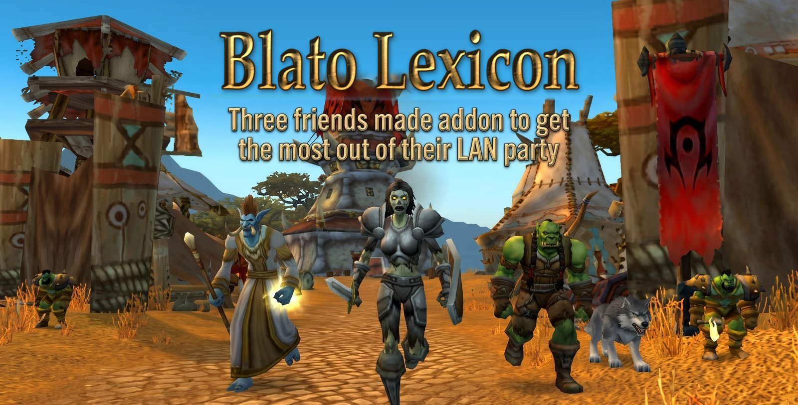
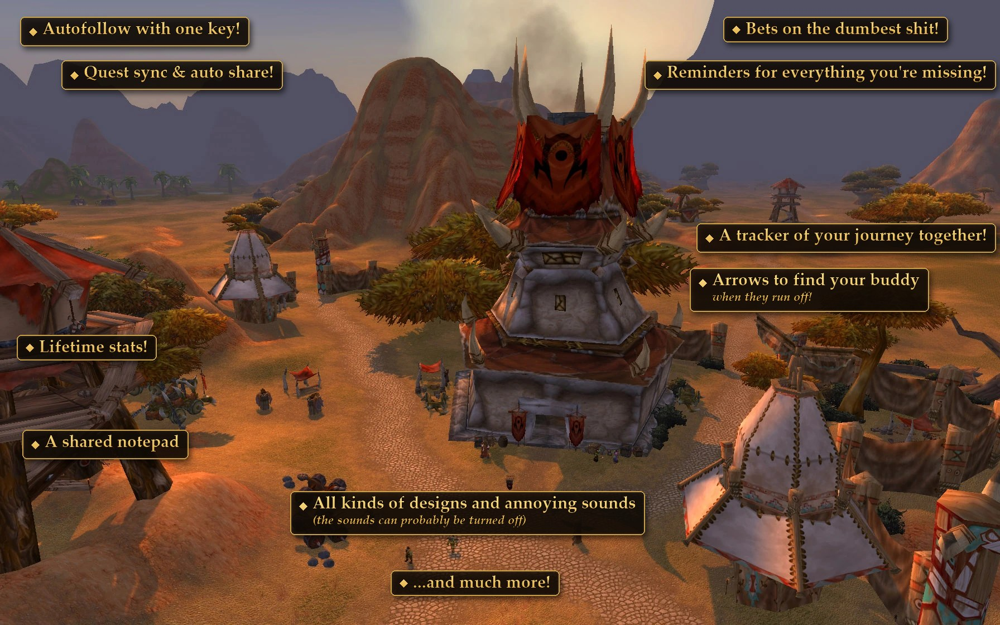

Three friends made this World of Warcraft addon to get the most out of their Bláto LAN party in **WoW Forever**.
If you are three friends playing your own LAN party together, feel free to use it.

## What it does

The **Blato Lexicon** window (minimap button or `/blato`) looks like WoW Forever's own windows (the options also offer a parchment page and a classic look) and has these tabs:

| Tab | What is on it |
|---|---|
| **Commands** | Every party feature as a button: tonight's statistics (including who was AFK and for how long), quest sharing, an arrow to a friend who ran off, alert cards, auction house and crafting helpers, bets and the options. Switches have a check box; hovering a button shows what it does and its command. |
| **Journey** | What the three of you have done together: time, shared quests, dungeons (runs, clears, bosses) and the firsts you shared. Below that, your own character's path, level by level. |
| Places | The zones and dungeons you have visited. |
| **Quests** | The quests you handed in, and for each one who of the three of you has done it (✓), has not (✗) or is not known yet (?). On top: quests your friends have done and you have not. |
| **Notes** | Notes with reminders ("I owe my buddy 12 gold"), and a notepad shared with your party: tick "Share with the party" and your friends read the note too. |

Most party features come alive when all three of you run the addon. Your party mates are the two players you have spent the most time grouped with.

## Install

1. Download the latest `BlatoLexicon_vX.Y.Z.zip` from [Releases](../../releases).
2. Unzip it into the `Interface/AddOns` folder of your WoW Forever installation (this gives `Interface/AddOns/BlatoLexicon`).
3. Restart the game if it is running: a new addon, or an update that changes the addon's file list, is not picked up by `/reload`.

Upgrading from version 0.1.x, when this addon was still called Bláto Journal: delete the `Interface/AddOns/BlatoJournal` folder first, the two cannot run side by side. To keep your data, with the game closed, rename every `BlatoJournal.lua` to `BlatoLexicon.lua` under `WTF/Account` (in the account's `SavedVariables` folder and in each character's).

**Check before you delete anything:** the old version has `Journal` and `Party` folders inside. A `BlatoJournal` folder without them is a different addon, Blato Journal 1.x. It runs fine next to this one, so leave it and its saved files alone.

## Commands

- `/blato` opens the Commands tab
- `/blato sleep` starts the "One more quest?" / "Bed time" vote
- `/blato help` lists every party command
- `/bl` or `/lexicon` opens the lexicon, `/note` writes a quick note

## Where it comes from

Blato Lexicon joins two addons and changes them:

- **ForeverJournal** by Ugge Zen (MIT, see [LICENSES/ForeverJournal-MIT.txt](LICENSES/ForeverJournal-MIT.txt)): the journal, its window and tabs (`BlatoLexicon/Journal`, `Media`, `Art`, `Setup`).
- **One More Quest** by MadDadVibe (GPL-3.0): the party features (`BlatoLexicon/Party`). It uses data from [Questie / QuestieDB](https://github.com/Questie/QuestieDB) (GPL-3.0) and the skill-up thresholds of [SkillUp Forever](https://github.com/cjber/skillup-forever) by cjber (GPL-3.0).

Changes from the originals:

- a new **Commands** tab with buttons for every party feature (`BlatoLexicon/Blato.lua`, `BJ.RenderCommands` in `Journal/UI.lua`);
- a classic look as an extra style (`UI.Chrome` in `Journal/UI.lua`, its own parchment `Media/Parchment.tga`);
- a Journey about the party of three (`J.Together` in `Journal/Fellowship.lua`) and, on the Quests page, who has done each quest (`Together.lua`, messages JQD/JQH/JQA);
- no Goals and no Fellowship tab (party mates are still recorded);
- "Time AFK" in tonight's statistics;
- a shared notepad: notes marked shared go to the party (`Together.lua`, messages JN/JNX/JNQ);
- left out from One More Quest: automatic quest accepting and turn-in, Shift-click heals, the Dad UI, the chat filter, the guided tour, selling grey items, the group quest tracker, the arrows to places and quests, the meeting point, and the dungeon tools (Group Check, Progress Check, threat meter, dungeon quests and loot);
- the arrow also shows the friends left behind who ran off from the group, not only the one who fell behind (`A:Evaluate` in `Party/Arrow.lua`);
- renamed globals, saved variables and commands (`/blato`, `/bl`), so Blato Lexicon can be installed next to the originals;
- the simulator (`/blato sim`) starts with 2 party mates and never sends real mail.

## License

GPL-3.0, see [LICENSE](LICENSE). The parts from ForeverJournal are under the MIT license, whose text is in [LICENSES/ForeverJournal-MIT.txt](LICENSES/ForeverJournal-MIT.txt).
